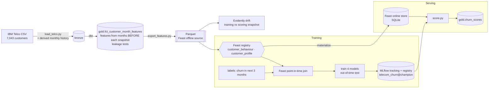

# Telecom Churn Feature Store

[](https://github.com/Saigwe/telecom-churn-feature-store/actions/workflows/ci.yml)

> An end-to-end churn pipeline on the IBM Telco data (7,043 customers): point-in-time features in dbt with leakage tests, Feast for training sets and online serving, models tracked and registered in MLflow, batch scoring from the online store, and Evidently drift reports. Proven consistent: Feast's point-in-time join and its online store both reproduce the dbt features exactly. A deliberately leaky model shows how much a non-point-in-time table overstates.

**Author:** Stanley Igwe, Lead Data (Analytics) Engineer · [Portfolio](https://saigwe.github.io)
**Stack:** Python · DuckDB · dbt Core (unit tests) · Feast 0.67 (file offline store, SQLite online store) · MLflow 3.17 (tracking + registry) · scikit-learn · Evidently 0.7 · pytest · GitHub Actions
**Status:** Core build complete on the IBM Telco data. See [Roadmap](#roadmap).

Project 15 of my portfolio plan. At a Big Four firm I designed churn-propensity, segmentation and next-best-offer models for a telecoms operator, with auditable validation controls. This repo rebuilds the problem on public and synthetic data. No employer or client data, code or logic is used.

---

## 90-second summary
| | |
|---|---|
| **Problem** | Churn models look great in a notebook and then disappoint in production. The usual cause is training on values the model can't know at prediction time, and serving features computed differently from training. |
| **What I built** | Monthly snapshots whose features read only earlier months, enforced by tests. Feast builds training sets with its point-in-time join and serves the same features online. Four models are compared out of time and the best honest one is registered as `telecom_churn@champion`. Scores are read from the online store and written back to the warehouse, and a drift report runs against the training reference. |
| **Why it matters** | Retention teams get a ranked list they can trust: the score a customer gets in production is computed exactly as in training, and offline numbers aren't inflated by leakage. |
| **Proof** | [Numbers](#numbers), from `make all` on the real file. Reports in [`results/`](results). CI runs the same pipeline on every push. |

## Training and serving


## Data
- **Real:** [IBM Telco Customer Churn](https://github.com/IBM/telco-customer-churn-on-icp4d/blob/master/data/Telco-Customer-Churn.csv), from IBM's public repository (no Kaggle sign-in needed). It has 7,043 customers, of whom 1,869 churned, with contract, services, payment method, tenure, monthly and total charges, as one snapshot.
- **Derived monthly history** (fixed seed, `ingestion/load_telco.py`), 227,990 customer-months. The snapshot is placed at December 2025. Customers who stayed were active for their `tenure` months up to then; churners' last months are spread evenly across 2025.
  - **Charges are real-derived:** a ramp to today's monthly charge that sums to each customer's real TotalCharges, checked to $0.50 for all 7,043.
  - **Usage is synthetic:** data, minutes, support tickets and late days, with drift planted in churners' last three months. Results are reported with and without it.

## Point-in-time design
- One row per active customer per monthly snapshot (January 2025 to January 2026): 66,992 rows. Every usage feature reads only months *before* the snapshot, and `feature_cutoff_month` records the latest month actually read.
- **Label:** the customer churns within the next 3 months. It's null where that window runs past the data, so those rows are for scoring.
- **Split:** train on January–May 2025 snapshots, whose label windows had closed by August. Test on August–October 2025: a model trained in August is judged on months it hadn't seen.
- **Extract-time columns:** IBM's `tenure` and `TotalCharges` describe December 2025, so they're kept only with an `extract_` prefix and never used as features for earlier snapshots. The point-in-time versions come from the monthly history.

## Tests
- **dbt leakage test:** no row reads its snapshot month or later. Total charges and tickets are also recomputed independently from earlier months only, and must match.
- **dbt unit test:** usage in the snapshot month and after (planted with huge values) never reaches the features; the label looks forward.
- **Labels:** present exactly when the label window is observable.
- **Feast vs dbt:** the training set from Feast's point-in-time join equals the dbt rows (**0 mismatches** on 41,341 rows).
- **Online vs offline:** every feature served from the online store equals the offline row (**0 mismatches** on 5,163 customers).
- **Registry:** the champion alias exists and its run is never the leaky model.
- **Drift control:** splitting the training months in half by customer shows no drift, so the drift test isn't firing on noise.

## Numbers
From `make all` on the real file, on a laptop.

| Metric | Value |
|---|---|
| Customers / customer-months / feature rows | 7,043 / 227,990 / 66,992 |
| dbt build | 20 nodes (5 models, 14 data tests, 1 unit test) in 2.4 s |
| Training / test rows (out of time) | 26,015 / 15,326; test churn rate within 3 months 7.6% |

**Out-of-time test** ([results](results/model_comparison.md)):

| Model | Features | ROC AUC | PR AUC | Lift, top 10% | Brier |
|---|---|---:|---:|---:|---:|
| Logistic regression | real-derived | 0.842 | 0.317 | 4.22x | 0.060 |
| Gradient boosting | real-derived | 0.815 | 0.309 | 3.93x | 0.066 |
| Gradient boosting (**champion**) | real + synthetic usage | 0.913 | 0.621 | 6.42x | 0.044 |
| Gradient boosting, **leaky** | real-derived, but extract-time tenure and charges | 0.853 | 0.515 | 4.77x | 0.055 |

- **Leakage, measured:** swapping two point-in-time columns for their December 2025 values lifts gradient boosting from 0.815 to 0.853 ROC AUC and from 0.309 to 0.515 PR AUC. That's the inflation a non-point-in-time table would report.
- On the real-derived features alone, plain logistic regression beats gradient boosting. Customers repeat across snapshots, so trees overfit even with large leaves and early stopping.
- **Champion caveat:** the champion's gain comes from synthetic usage with planted drift. It shows the pipeline uses those features, not what real usage would add. `telecom_churn@real_features_only` is registered too.

**Scoring** ([results](results/scoring.md)): 5,163 active customers scored for January 2026 from the online store. The model expects 491 churners in the next 3 months. The top risk decile is 517 customers with a mean probability of 56.9%, 84% of them on month-to-month contracts.

**Drift** ([results](results/drift.md), [full Evidently report](results/drift_report.html)): 8 of 26 features drift between training and the scoring snapshot. The biggest are `charge_change_vs_6m`, tenure and charges, because the scoring population is the survivors (customers who stayed tend to have longer tenure and higher charges). That's the case for retraining on recent snapshots. The control split shows 0 of 26.

## How to run
Requires **Python 3.12** (what CI uses) and `make`, or run the commands in the `Makefile` by hand.
```bash
python -m venv .venv && source .venv/bin/activate   # Windows: .venv\Scripts\activate
pip install -r requirements.txt
make download && make all    # real IBM file: load, dbt, Feast, MLflow train + register, score, drift, tests
make fixture-all             # synthetic Telco-format CSV through the same pipeline (CI)
mlflow ui --backend-store-uri sqlite:///mlflow.db   # browse runs and the registry
```
`make fixture-all` writes to the same Feast, MLflow and `results/` locations as `make all`, so rerun `make all` afterwards.

## Roadmap
- [x] Scaffold: fixture, staging with key tests, first marts, CI
- [x] Load the IBM Telco data and derive monthly history (charges tied to the real totals; usage synthetic)
- [x] Point-in-time features in dbt (only months before the snapshot), leakage tests and a unit test
- [x] Register features in Feast with offline (Parquet) and online (SQLite) stores; training-serving consistency tests
- [x] Train and register models in MLflow (champion alias); batch scoring from the online store
- [x] Drift report with Evidently, with a control split; training-serving diagram in the README
- [ ] Next-best-offer: uplift model on a simulated retention campaign
- [ ] Serve the champion behind a REST endpoint reading Feast online features
- [ ] 3-minute Loom walkthrough ([script ready](docs/walkthrough.md))

## Interview topics this project prepares
- Point-in-time correctness and leakage, and how to measure what leakage costs
- Feature stores: offline vs online, point-in-time joins, training-serving skew
- Model registry and promotion (aliases), out-of-time validation, calibration
- Drift monitoring and how to tell real drift from noise

## Data and licence
- **IBM Telco Customer Churn:** sample data published by IBM in its public repository.
- **Derived history and CI fixture:** generated with fixed seeds in this repo; they describe no real person.
- **Code:** MIT (see `LICENSE`).
