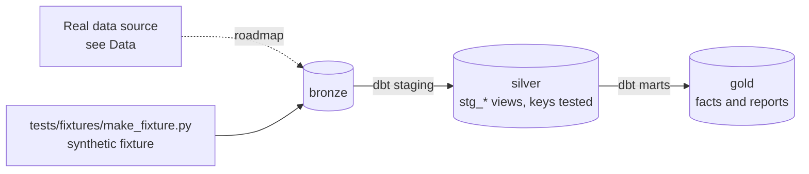

# Telecom Churn Feature Store

[](https://github.com/Saigwe/telecom-churn-feature-store/actions/workflows/ci.yml)

> Point-in-time correct churn features in dbt, served through a Feast feature store to a tracked model, with drift monitoring: the same features for training and serving, and no leakage.

**Author:** Stanley Igwe, Lead Data (Analytics) Engineer · [Portfolio](https://saigwe.github.io)
**Stack:** dbt Core · Feast · scikit-learn or LightGBM · MLflow · Evidently · DuckDB
**Status:** 🚧 Scaffolded. Fixture pipeline passes: `dbt build` 10/10. See [Roadmap](#roadmap).

Project 15 of my portfolio plan. At a Big Four firm I designed churn-propensity, segmentation and next-best-offer models for a telecoms operator, with auditable validation controls. This repo rebuilds the problem on public and synthetic data. No employer or client data, code or logic is used.

---

## 90-second summary
| | |
|---|---|
| **Problem** | TODO: one sentence on the business problem. |
| **What I built** | TODO: fill in as the roadmap lands. |
| **Why it matters** | TODO: the decision this enables, in the user's words. |
| **Proof** | TODO: link to [Numbers](#numbers), with every claim reproducible. |

## Architecture


## Data
Real data: [IBM Telco Customer Churn](https://www.kaggle.com/datasets/blastchar/telco-customer-churn), with synthetic monthly usage added. CI uses a synthetic customers and monthly-usage fixture.

| Bronze table (fixture) | Rows |
|---|---|
| `bronze.customers` | 2,000 |
| `bronze.usage_monthly` | one per customer per `MS` period, 2025-01-01 to 2025-06-01 |

## Data model (gold layer, first cut)
| Model | Purpose |
|---|---|
| `fct_customer_month_features` | One row per customer and snapshot month. Features use ONLY months before the snapshot |

## Tests in place
- Staging: `unique` / `not_null` on every key, and `relationships` on every foreign key
- Marts: grain tests (`unique_combination`) and accepted values
- Business rules: `assert_no_feature_leakage`

## Numbers
*(Fill from real runs. Never estimate.)*
| Metric | Value |
|---|---|
| Rows processed (real data) | _tbd_ |
| dbt models / tests | _tbd_ |
| `dbt build` runtime | _tbd_ |

## How to run
Requires **Python 3.12** (what CI uses) and `make`, or run the commands in the `Makefile` by hand.
```bash
python -m venv .venv && source .venv/bin/activate   # Windows: .venv\Scripts\activate
pip install -r requirements.txt
make fixture-all   # synthetic fixture -> dbt build (used in CI)
```

## Roadmap
- [x] Scaffold: synthetic fixture, staging with key tests, first marts and business-rule tests, CI
- [ ] Load the IBM Telco data and generate monthly usage
- [ ] Point-in-time features in dbt (only months before the snapshot); a leakage test
- [ ] Register features in Feast with offline and online stores
- [ ] Train and register a model in MLflow; batch scoring
- [ ] Drift report with Evidently; a training-serving diagram in the README
- [ ] Fill in [Numbers](#numbers) and the [design doc](docs/design_doc.md)
- [ ] 3-minute Loom walkthrough

## Interview topics this project prepares
- Point-in-time correctness and leakage
- Feature stores
- Training-serving skew
- Model monitoring

## Data and licence
- **Fixture:** synthetic, generated with a fixed seed by `tests/fixtures/make_fixture.py` from `fixture_spec.yml`. It describes no real company or person.
- **Real data:** see [Data](#data) for each source's own licence and terms.
- **Code:** MIT (see `LICENSE`).
